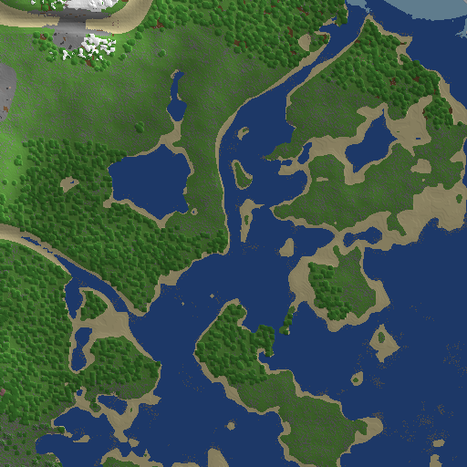
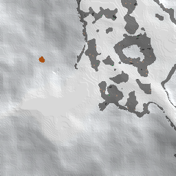

# RealisticTerrain

面向 **Minecraft 1.18+** 的服务端地形生成插件：用多噪声重建大陆、海岸、山脉、河流与气候带，**地形最高生成到 y=304**，洞穴明显更稀疏，并兼容 **Folia**。

同一个 jar 只使用 Bukkit API，不碰 NMS，设计上可以从 **1.18** 一直向上运行到 **26.x**。



> 图：Paper 1.20.6，种子 `20261101`，512×512 方块。海岸、沙洲、河流、森林和雪原都由生成器实时计算。

---

## 特性

- **更真实的地形结构**：大陆度、侵蚀度、山脊、细节噪声和域扭曲叠加，形成大陆架、群岛、海岸、河谷、丘陵与连绵山脉，而不是均匀的“噪声馒头”。
- **地形上限 y=304**：主世界从 y=-64 到 y=320，插件把地形最高点限制在 **304**，上方留给树木、建筑和天空；默认海平面 96，高山雪线 266。
- **稀疏洞穴**：默认 `caves.density: 0.35`。先用低频“洞穴富集区”圈定范围，再用窄噪声带生成隧道、极少数大型洞窟；不会像原版那样把地下挖成筛子。
- **现代地层**：y<0 自动生成深板岩，附凝灰岩、花岗岩、闪长岩、安山岩团块；矿物按深度分布，深板岩层使用对应的深板岩矿。
- **地表细节**：沙滩、雪滩、石岸、海底沙/砾/黏土、雪线、裸岩、恶地彩色陶瓦条带、针叶林灰化土、热带草原粗泥等。
- **Folia 支持**：`folia-supported: true`；区块生成不调用 Bukkit 调度器、不访问主线程世界对象，生成器标记为并行安全，临时数组使用 `ThreadLocal`。
- **向上兼容**：用 1.18 就存在的 Bukkit API 编译（Java 17 字节码）；群系名全部反射解析，兼容 1.18 的枚举、1.21+ 的新群系，以及 26.x 把 `Biome` 改成接口的变化。
- **自带预生成命令**：Paper 走异步区块加载，Folia 走区域线程，方便开服前生成地图。

---

## 兼容性

| 服务端 | 版本 | 状态 |
| --- | --- | --- |
| Paper | 1.20.6 | ✅ 实测生成 1300+ 区块，渲染验证海岸、山脉、洞穴、矿物 |
| Folia | 26.3 | ✅ 实测识别为 Folia，生成 289 个高山区块 + 81 个出生点区块，峰值 y=305 |
| Paper / Spigot 系 | 1.18 ~ 1.21.x / 26.x | 🟡 只使用 1.18 起就有的 API，未逐一实机测试 |
| 1.17 及以下 | — | ❌ 不支持（没有 1.18 的高度与区块 API） |

Java 版本随服务端要求：1.18 ~ 1.20.4 需要 Java 17，1.20.5+ 需要 Java 21，26.x 需要 Java 25。

---

## 安装

1. 把 `RealisticTerrain-1.0.0.jar` 放进服务端的 `plugins/`。
2. **新建世界**，在 `bukkit.yml` 里指定生成器：

   ```yaml
   worlds:
     world:
       generator: RealisticTerrain:realistic
   ```

   如果使用 Multiverse 等世界管理插件，创建世界时把 generator 填成
   `RealisticTerrain:realistic`。

3. 重启服务端。控制台出现下面的日志说明生效：

   ```
   [RealisticTerrain] 真实地形生成器已启用（常规服务端），海平面 y=96，地形最高 y=304，洞穴密度 0.35。
   ```

> ⚠️ **只影响新生成的区块。** 已经生成过的区块不会被改写。不要直接给一个玩过的原版世界切换生成器，否则新旧地形会在区块边界硬拼接；请使用新世界，或在备份后清空区块。
>
> ⚠️ 不要把生成器配置给 `world_nether` / `world_the_end`，否则下界/末地也会变成主世界地形。本插件只重写主世界。

---

## 命令与权限

| 命令 | 说明 |
| --- | --- |
| `/realisticterrain info`（别名 `/rt`、`/rterrain`） | 查看生成器状态、实际海平面/地形上限/雪线 |
| `/realisticterrain biome [x z]` | 不加载区块，直接查询坐标处的群系、地表高度、山脉强度 |
| `/realisticterrain pregen [半径] [x z]` | 预生成以玩家（或指定坐标）为中心的区块；半径 1~32 |
| `/realisticterrain reload` | 重载配置；只影响之后新生成的区块 |

权限：`realisticterrain.admin`（默认 OP）。

`pregen` 会按平台选择正确的线程：Paper 使用异步区块加载，Folia 使用拥有目标区块的区域线程。一次生成太多区块会占用磁盘和内存，建议按需使用。

---

## 高度模型

1.18 主世界的默认范围是 **-64 ~ 320**。本插件使用：

| 项目 | 默认值 | 说明 |
| --- | --- | --- |
| 世界最低点 | y=-64 | 由世界自身决定 |
| 基岩层 | y=-64 ~ -62 | 3 层，边缘带随机缺口 |
| 海平面 | y=96 | 可配置 |
| 地形上限 | y=304 | 可配置，最终会被“世界最大高度 - 16”钳制 |
| 雪线 | y=266 | 由海平面推导；石峰会再高 26 格 |
| 深板岩 | y<0 | 深板岩矿同步生成 |

因此，“地形最高 304 格”指的是**地形方块的绝对 Y 上限为 304**，不是世界总高度 304。1.18 原版世界本来就有 320 的高度，这个插件把可用地形抬高到 304，并把海平面放在 96，让海洋、平原和高山都有足够空间。


> 图：同一座山体的俯视。雪线以上是积雪，雪线附近和陡坡露出灰色裸岩；地形峰值 304，最上面一层雪在 305。

---

## 配置

`plugins/RealisticTerrain/config.yml`：

```yaml
world:
  sea-level: 96          # 海平面（绝对 Y）
  max-terrain-y: 304     # 地形最高点（绝对 Y）
  bedrock-depth: 3       # 基岩层厚度 1~5

terrain:
  continent-scale: 1.0   # 大陆尺度；大于 1 大陆更大
  height-scale: 1.0      # 整体高度缩放（以海平面为中心）
  mountain-height: 170   # 山脉最大抬升
  ocean-depth: 58        # 深海最大深度
  roughness: 1.0         # 悬崖/山脊/局部悬垂强度
  rivers: true
  river-width: 1.0

caves:
  enabled: true
  density: 0.35          # 0.0~1.5；默认比常规稀疏很多
  lava-level: -54        # 低于此高度的洞穴填岩浆
  lava-lakes: true

ores:
  enabled: true
  density: 1.0
  geology: true          # 花岗岩/闪长岩/安山岩/凝灰岩/砂砾团块

features:
  vanilla-decoration: true   # 原版树木/花草/雪层/海草
  vanilla-structures: false  # 自定义地形上结构容易悬空，默认关闭
  vanilla-mobs: true

debug: false
```

所有数值都会在加载时钳制到安全范围，写错不会让生成器抛异常。

### 关于洞穴密度

`caves.density` 不是“洞穴数量”的线性倍率，而是隧道宽度和洞窟阈值的综合系数：

- `0.35`（默认）：隧道更细，且只在约一半的“洞穴富集区”出现；大型洞窟非常稀有。
- `1.0`：接近常规密度。
- `0.0`：完全关闭洞穴。
- 大于 `1.0`：更密，但不建议超过 `1.5`。

插件还会限制地表附近的开口：只有“入口列”才允许在近地表挖洞，避免整片地表被挖成筛子。

---

## 它是怎么工作的

### 1. 地形场

每列地形由几组不同尺度的 Perlin 噪声叠加：

- **大陆度**：决定深海、浅海、海岸和内陆；
- **侵蚀度**：低侵蚀形成山脉和陡坡，高侵蚀形成平原；
- **山脊**：低频脊状噪声 + 高频碎裂噪声，形成连绵山脉而不是孤立尖峰；
- **细节/微噪声**：丘陵、河岸和局部起伏；
- **域扭曲**：让海岸线、山脉和河流不再是规则圆斑；
- **河流**：在陆地上切出浅河谷，水面统一填充到海平面。

高度以海平面为基准，先算海洋基底/陆地基底，再叠加丘陵、山脉、河谷，最后做软顶压缩，避免大量山峰被硬切成平台。

### 2. 三维密度与洞穴

地形填充不是简单的“高度以下全是石头”：

- 用 `4×8×4` 密度网格 + 三线性插值，在靠近地表处叠加三维噪声，制造悬崖、山脊和局部悬垂；
- 噪声在离地表 14 格内最强，30 格外淡出，避免出现成片浮空岛；
- 洞穴在填充之后单独挖：两条窄噪声带相交形成隧道，第三个低频噪声形成极少数大厅；
- 洞穴只替换石头/深板岩/凝灰岩等，不破坏水、基岩和岩浆；
- 低于 `lava-level` 的洞穴填岩浆。

### 3. 群系与地表

群系按大陆度、温度、湿度、侵蚀度、海拔和河流强度选择，覆盖海洋、沙滩、石岸、雪原、针叶林、森林、白桦林、黑森林、平原、向日葵平原、草甸、雪坡、风袭丘陵、风袭森林、砂砾山地、尖峭山峰、冰封山峰、石峰、沙漠、恶地、热带草原、丛林、沼泽、蘑菇岛等 30 多种。

地表材质按群系、海拔、坡度和水下状态分层：

- 普通草地：草方块 + 泥土；
- 沙滩/沙漠：沙 + 砂岩；
- 恶地：红沙 + 陶瓦 + 彩色条带；
- 高山：草 → 裸岩 → 积雪，陡坡直接露岩；
- 水下：沙、砂砾、黏土按深度和噪声混合；
- 雪原/雪林/雪坡会额外铺雪层，冻洋/冻河会结冰。

### 4. 矿物

每个区块用“世界种子 ^ 区块坐标”作为确定性随机种子，生成煤、铜、铁、金、红石、青金石、钻石、绿宝石，以及花岗岩/闪长岩/安山岩/凝灰岩/砂砾/泥土团块。只替换石头/深板岩类方块，不会把矿嵌进空气、水或洞穴。

### 5. 与 Paper/Folia 的关系

Bukkit 的 `ChunkGenerator#generateNoise` 在 Paper/Folia 中本来就在区块工作线程上调用。插件把地形、水、洞穴、地表、基岩、矿物全部放在这一个阶段完成，其余阶段返回 `false`：

- 不调用 `Bukkit.getScheduler()`；
- 不读取/写入世界对象；
- 不使用 NMS、Mojang 映射或 Paper 内部类；
- `isParallelCapable()` 返回 `true`；
- 每个线程各自持有一份 `ChunkScratch`。

`shouldGenerateNoise()` 返回 `false` 是关键：在 Paper 里它的语义是“是否让原版噪声生成器也跑一遍”。返回 `false` 才是真正接管地形；返回 `true` 会让原版地形先铺一遍。

---

## 版本兼容说明

- 编译目标：Java 17 字节码，`api-version: 1.18`。
- 只使用 1.18 起存在的 Bukkit API；`Biome` 通过反射按候选名查找，所以：
  - 1.18 的枚举群系；
  - 1.19/1.20 新增的 `MANGROVE_SWAMP`、`CHERRY_GROVE`（不存在时自动回退）；
  - 26.x 把 `Biome` 改成接口；
  都能加载。
- Folia 相关类全部通过反射/类名字符串探测，jar 内不引用 Folia 类，放在普通 Paper/Spigot 上不会 `NoClassDefFoundError`。
- **已实测**：Paper 1.20.6、Folia 26.3。
- **未逐一实测**：1.18 ~ 1.21.x 的每个小版本。若某个版本改了 Bukkit 区块 API，请带日志反馈。

---

## 性能

测试机（Windows，6 个区块生成线程）上，地形生成约 **50 ~ 70 ms/区块**；首次生成还会包含类加载和噪声初始化，前几个区块会到 200 ms 左右。

建议：

- 开服前用 `/rt pregen` 或 Chunky 等工具预生成；
- 不需要洞穴/矿物时关闭 `caves.enabled` / `ores.enabled`；
- 不要把 `pregen` 半径开得过大，一次生成数千区块会明显增加磁盘和内存压力；
- 多个世界共用同一个种子时，噪声实例按“种子 + 世界高度 + 配置版本”缓存。

---

## 构建

需要 JDK 17+ 和 Maven：

```bash
mvn clean package
```

产物：`target/RealisticTerrain-1.0.0.jar`。

本项目在 JDK 21 下编译，目标字节码 17。离线环境默认跳过测试；本地仓库齐全时：

```bash
mvn -Ptests test
```

或手动运行：

```bash
java -cp "target/classes;target/test-classes;...;junit-4.12.jar;hamcrest-core-1.3.jar" \
  org.junit.runner.JUnitCore \
  com.says.realisticterrain.terrain.SettingsTest \
  com.says.realisticterrain.terrain.TerrainSamplerTest
```

### 目录

```
src/main/java/com/says/realisticterrain/
├── RealisticTerrainPlugin.java     插件入口、世界缓存、配置版本
├── biome/                          群系表、地表模板
├── terrain/                        高度场、密度场、洞穴、地表、矿物、区块拼装
├── generator/                      Bukkit ChunkGenerator / BiomeProvider
├── compat/                         Folia 探测、调度、群系反射映射
├── config/                         config.yml 读取
├── command/                        命令
├── noise/                          Perlin / 分形噪声 / 确定性随机
└── util/                           聊天前缀
tools/                              测试用 RCON 客户端与区域文件渲染脚本（不打包）
docs/                               README 预览图
```

---

## 已验证记录

- **Paper 1.20.6**（Java 21）：用 `generator: RealisticTerrain:realistic` 创建新世界，预生成 1024 个出生点区块 + 289 个高山区块；渲染确认海岸、沙滩、河流、森林、雪原、深板岩、洞穴、矿物和基岩正常；实测高度 96 ~ 305。
- **Folia 26.3**（Java 25）：插件被识别为 Folia；通过区域线程预生成 289 个高山区块和 81 个出生点区块；渲染确认峰值 y=305，无生成异常。
- **单元测试 7 个全部通过**：噪声确定性/高度范围/海洋与山地比例/群系多样性/洞穴稀疏度/配置钳制/世界高度适配。



> 图：Folia 26.3 上生成的同一座山，峰值 304（顶部雪层 305）。

---

## 常见问题

**Q：能直接给已经玩过的原版世界换生成器吗？**
A：不能。Bukkit 生成器只对未生成的区块生效，已生成区块不会重算。请新建世界，或备份后清空区块。

**Q：为什么出生点在海里/河里？**
A：出生点由服务端原版逻辑选择，插件只负责地形。可以先用 `/rt biome` 探路，或进服后用 `/tp` 去大陆；也可以在服务端配置里指定出生点。

**Q：为什么还能看到原版的雪、冰、树或矿物？**
A：`features.vanilla-decoration: true` 会保留原版植被/雪层/海草，同时原版的矿物特征也可能额外生成。要完全控制地表，把它设为 `false`，但世界会变得非常光秃。

**Q：结构（村庄、要塞、废弃矿井）为什么没有？**
A：`features.vanilla-structures` 默认关闭。自定义地形上原版结构容易悬空；打开前请自行评估。

**Q：洞穴太少了/太多了？**
A：调 `caves.density`：默认 `0.35` 偏稀疏，`1.0` 接近常规，`0.0` 关闭。改完 `/rt reload`，只影响新区块。

**Q：Folia 上安全吗？**
A：区块生成路径不调用调度器、不访问世界对象；临时数组每线程一份。`pregen` 在 Folia 上通过区域调度器加载区块，已在 Folia 26.3 实机生成验证。

**Q：支持 1.17 及以下吗？**
A：不支持。1.18 才引入当前的高度/区块生成 API；1.17 也不需要这个插件。

---

## 许可

插件代码以 MIT 协议发布。Minecraft 是 Mojang Studios 的商标；本项目不包含任何 Mojang 代码/资源，地形算法为独立实现。
